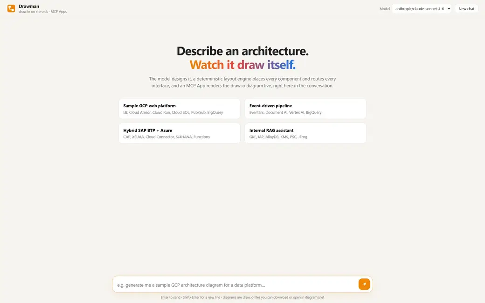

<h1 align="center"> Drawman </h1>

<h3 align="center"><em>draw.io on steroids</em></h3>

<p align="center">
  
</p>

**Much cheaper, extremely fast, high-quality diagrams for AI coding agents.** The model writes a short description of
what exists and how it connects; a deterministic engine does the layout, routing and draw.io XML. That keeps output
tokens tiny, diagrams appear in seconds, and every result is clean and fully editable in draw.io.

Architecture (cloud, on-premises, SAP, AI systems with official icons), flowcharts with swimlanes, sequence diagrams,
state machines, UML class diagrams, ER diagrams and repository analysis, in any direction (top-down, left-to-right,
right-to-left, bottom-up). Watch it build inside the chat, drag shapes and the lines re-route live, ask for changes
and everything already drawn stays exactly where it was, then export a native `.drawio` file.

It ships as an [MCP](https://modelcontextprotocol.io) server with an [MCP App](https://github.com/modelcontextprotocol/ext-apps)
view, so it runs in VS Code (GitHub Copilot), Claude, Copilot CLI, Cursor, or any MCP host. There is also a VS Code
extension and a standalone chat UI.

## Install

Requires [Node.js](https://nodejs.org) 20.11 or newer. Nothing to host, no API key: it runs locally next to your agent.

### Everything at once

Finds every supported AI tool and IDE on your machine and adds Drawman to each one:

```bash
npx -y drawman install
```

It keeps your existing settings, leaves configs it cannot parse safely untouched, and changes nothing when run twice.
Check the setup with `npx -y drawman doctor`; remove it with `npx -y drawman uninstall`.

### Claude Code

```bash
claude mcp add -s user drawman -- npx -y drawman
```

Optional plugin that also teaches Claude when to draw:

```bash
claude plugin marketplace add zamalali/drawman
claude plugin install drawman@drawman
```

### GitHub Copilot CLI

```bash
copilot mcp add drawman -- npx -y drawman
```

Optional plugin that also teaches Copilot when to draw:

```bash
copilot plugin marketplace add zamalali/drawman
copilot plugin install drawman@drawman
```

### VS Code (GitHub Copilot)

[**Install in VS Code**](https://vscode.dev/redirect/mcp/install?name=drawman&config=%7B%22command%22%3A%22npx%22%2C%22args%22%3A%5B%22-y%22%2C%22drawman%22%5D%7D), or from a terminal:

```bash
code --add-mcp '{"name":"drawman","command":"npx","args":["-y","drawman"]}'
```

### Cursor

[**Add to Cursor**](https://cursor.com/en/install-mcp?name=drawman&config=eyJjb21tYW5kIjoibnB4IiwiYXJncyI6WyIteSIsImRyYXdtYW4iXX0=)

### Codex CLI

```bash
codex mcp add drawman -- npx -y drawman
```

### Claude Desktop, Windsurf, Antigravity, Gemini CLI and any other MCP host

Add this to the host's MCP config file:

```json
{
  "mcpServers": {
    "drawman": { "command": "npx", "args": ["-y", "drawman"] }
  }
}
```

| Host | Config file |
| --- | --- |
| Claude Desktop | `%APPDATA%\Claude\claude_desktop_config.json` (Windows), `~/Library/Application Support/Claude/claude_desktop_config.json` (macOS) |
| Windsurf | `~/.codeium/windsurf/mcp_config.json` |
| Antigravity | `~/.gemini/antigravity/mcp_config.json` |
| Gemini CLI | `~/.gemini/settings.json` |

On Windows, use `"command": "cmd", "args": ["/c", "npx", "-y", "drawman"]`, because these hosts start servers without a
shell. Then restart the host.

### Try it

Ask your agent: *"draw the architecture of this repository"*, *"sequence diagram of the OAuth login"*, *"ER diagram for
an e-commerce schema"*, *"flowchart for handling a customer refund request"* or *"draw a Transformer"*.

Hosts that render MCP Apps (VS Code with Copilot, Cursor, Claude Desktop) show the live canvas in the chat, with
drag-to-edit, Download and Open in draw.io. Terminal agents (Claude Code, Copilot CLI, Codex, Gemini CLI) get
`diagrams/<title>.drawio` in the project plus a `diagrams/<title>.drawio.html` link that opens it in the draw.io web
editor. The diagram travels in the URL fragment, so it is never uploaded anywhere. More in
[docs/integrations.md](docs/integrations.md).

### Remote / shared (Streamable HTTP)

```bash
npx -y drawman serve --port 3001   # http://127.0.0.1:3001/mcp, stateless, localhost only; put auth in front before exposing it
```

### Without any agent

```bash
npx -y drawman render examples/order-platform.json -o order.drawio
npx -y drawman analyze ./my-service -o my-service.drawio    # needs DRAWMAN_LLM_* (see .env.example)
```

### From source

```bash
git clone https://github.com/zamalali/drawman && cd drawman
npm install
npm run build          # downloads official icons (see NOTICE), builds the view, web UI and CLI
npm test
npm run build:vscode   # optional: dist/drawman.vsix, a VS Code extension that registers the server itself
DRAWMAN_LLM_URL=... DRAWMAN_LLM_KEY=... npm start     # standalone chat UI on :5179
```

## Why the diagrams look good

The model never places anything. It only describes **what exists and how it talks**, as a semantic graph over a closed
vocabulary of about 150 kinds. Everything visual is deterministic:

| Layer | What it does |
| --- | --- |
| Vocabulary | each kind fixes its platform frame, its zone (edge, runtime, data, AI, security…) and its official icon |
| Layout | frames per platform, zones in columns, components ordered along the flow |
| Router | orthogonal A* on a 10 px grid: cards are hard obstacles; bends, overlaps, crossings and port reuse cost extra |
| Validation | unknown kinds are repaired through hints, dangling edges dropped, overlaps rejected before anything is shown |
| Repository analysis | deterministic scan with `file:line` evidence (workflows, Terraform, Bicep, SAP MTA, Dockerfiles, dependencies) → model → release-path enforcement from evidence |

Because the hard part is not the model's job, mid-size models produce the same quality as frontier models.

## Tools

| Tool | Purpose |
| --- | --- |
| `create_architecture_diagram` | title, subtitle, nodes `{id, kind, title, detail, status, group?}`, interfaces `{from, to, label, protocol, description}`; optional `containers` `{id, title, parent?}` only when the request names them (VPC, subnets, clusters, namespaces), otherwise platform frames and zones are drawn automatically |
| `create_flowchart` | flowcharts, processes, approval flows, decision trees: real flowchart shapes (start/end, process, decision, data, document, database, sub-process), Yes/No branches, optional swimlanes, top-down or left-right |
| `create_sequence_diagram` | API / auth / payment call flows: native UML lifelines, activation bars, sync / async / return messages, `alt` `opt` `loop` `par` fragments, notes |
| `create_state_diagram` | lifecycles and statuses: initial / final / choice pseudo-states, `event [guard] / action` transitions, entry / exit activities |
| `create_class_diagram` | domain models and OO designs: class / interface / abstract / enum boxes with attributes and methods, inheritance, realisation, composition, aggregation, association, dependency |
| `create_er_diagram` | database schemas: tables with typed columns, PK / FK, crow's-foot cardinalities |
| `create_diagram` | any other connected diagram (ML models, concept maps, org charts): optional groups `{id, title, parent?}` that can nest, nodes (a node without a group stays outside every group), interfaces |
| `analyze_repository` | `"."`, a workspace folder, `owner/repo` or an https git URL; optional `ref`, `focus` |

All of them accept `workspace` (the absolute project path), which agents that start servers outside the project (Copilot
CLI) pass so files are read from, and saved to, the right folder.

`analyze_repository` derives the architecture with a configured OpenAI-compatible endpoint, or hands the evidence to the
calling agent, which then draws the diagram while the server still applies the evidence-based release path. No key is
required. MCP sampling (the host's model) is opt-in with `DRAWMAN_SAMPLING=1`, because some headless hosts
announce it but never answer.

## Organisation profiles

Company conventions stay out of the code. Point `DRAWMAN_PROFILE` at a JSON file
([example](examples/profile.example.json)) with `conventions` (added to the tool descriptions and the architect prompt),
`hints` (internal product names → kinds), `endpoints` (internal hostnames → kinds), `githubHost` and `defaults`.

## Security

- Only folders inside the workspace are read: `DRAWMAN_WORKSPACE_ROOTS`, else the host's roots, else the
  project directory. Home, drive roots and the plugin folder are never used as a workspace; symlinks are skipped.
- Remote clones are shallow, https/ssh only (`GIT_ALLOW_PROTOCOL`), refs are validated, symlinks are not checked out;
  `DRAWMAN_ALLOW_CLONE=0` disables them.
- Credential files (`.env`, keys, keystores, tfstate, service-account JSON…) are never read; secrets in other files are
  masked before anything leaves the machine.
- The view runs in the host's sandboxed iframe with no network access; all user text is escaped.
- The HTTP servers bind to localhost and reject foreign `Host`/`Origin` headers (DNS rebinding); widen with
  `DRAWMAN_ALLOWED_HOSTS`.

See [SECURITY.md](SECURITY.md).

## Project layout

```
src/engine   vocabulary, layout, A* router, draw.io XML (pure, no I/O)
src/repo     scanner, repository resolver, architect, release-path enforcement
src/mcp      MCP server (tools + MCP App resource), Streamable HTTP
src/view     the MCP App (live canvas, drag-to-edit, export)
src/host     standalone chat UI (an MCP Apps host in the browser)
vscode       VS Code extension (MCP server definition provider)
scripts      icon builder (official sources), bundler
```

## License

Apache-2.0. Vendor icons are downloaded at build time from their official sources and are subject to their owners'
terms; see [NOTICE](NOTICE).
