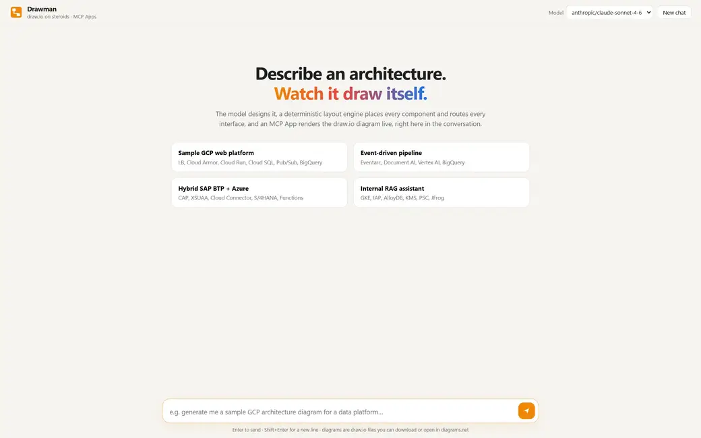

<h1 align="center">Drawman</h1>

<h3 align="center"><em>draw.io on steroids.</em></h3>

  

Ask GitHub Copilot to design or analyze an architecture, and watch a draw.io diagram build itself live in the chat:
components land in their platform frame (Google Cloud, Microsoft Azure, SAP BTP, on-premises) with official icons,
then every interface is routed around them. Drag cards and zones to rearrange; export to `.drawio` or open in diagrams.net.

## Use

The extension registers the **Drawman** MCP server automatically. In Copilot Chat (agent mode):

- *"Draw a GCP architecture for a customer-facing web app with Cloud Run, Cloud SQL and Pub/Sub"*
- *"Draw the architecture of this workspace"* (or run **Drawman: Draw the architecture of this workspace**)
- *"Analyze octo-org/payments and show the SAP integration"*

## Repository analysis needs no key

`analyze_repository` scans the code deterministically (workflows, Terraform, Bicep, SAP MTA, Dockerfiles, dependencies,
with file:line evidence; credential files are never read). The architecture is then derived by:

1. your own OpenAI-compatible endpoint, if you set `drawman.llm.baseUrl` and run **Drawman: Set LLM API key**, or
2. Copilot's model through MCP sampling (VS Code asks you once to allow it), or
3. Copilot itself, from the evidence the tool hands back.

Only folders of the open workspace can be read. Remote repositories are shallow-cloned to a temp folder (disable with
`drawman.allowRemoteClone`).

## Settings

| Setting | Purpose |
| --- | --- |
| `drawman.llm.baseUrl`, `llm.model`, `llm.keyHeader` | optional OpenAI-compatible endpoint for repository analysis |
| `drawman.githubHost` | host for `owner/repo` shorthands (GitHub Enterprise Server) |
| `drawman.profile` | organisation profile JSON: conventions, vocabulary hints, internal endpoints |
| `drawman.outputDir` | where saved `.drawio` files go |
